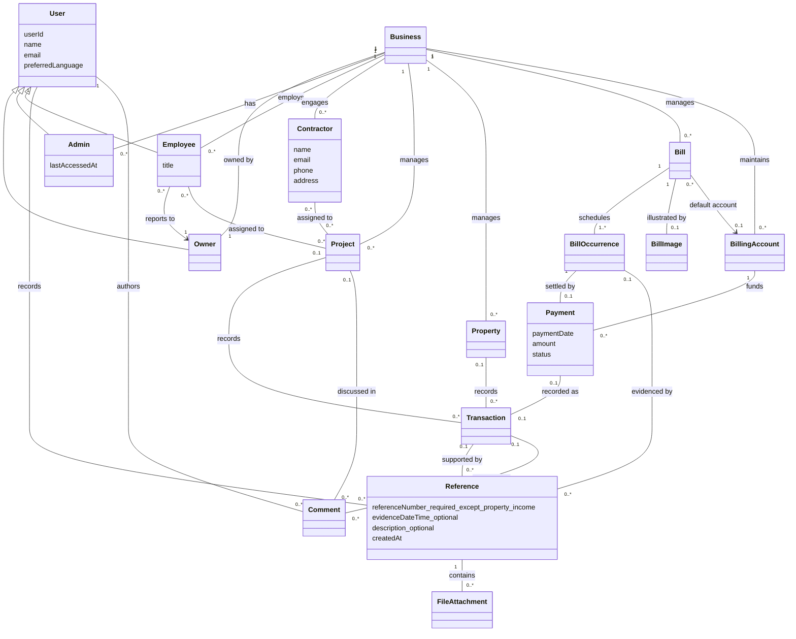

# Domain model

Contractors are external contacts, not users. Owner, Admin, and Employee are user roles; all employees report to the owner. Each user belongs to one business. References and payment states follow the agreed model, with primary references required except for property income.

Additional constraints: a reference has at least one target and requires a receipt ID except for property income; reference dates, notes and attachments are optional; a comment has exactly one target. A processed payment has exactly one expense transaction; processing/failed payments have none. Shared transaction/occurrence references identify the same payment. Monetary storage uses cents; project balances are derived. The implementation uses role columns and assignment relations rather than separate Owner/Admin/Employee tables.

Manual transactions target exactly one project or property. Payment-generated expenses target their standalone bill instead and never affect project/property balances. Project budgets default to zero. Reporting supports YTD (default), this month, trailing three months, trailing twelve months, and lifetime; income and refunds remain distinct amounts. Team navigation is hidden; property and standalone bill records are visible to owners/admins only.

Property income can be recorded with just amount and date, with an optional name defaulting to Rent income. Its primary reference is nullable; refund and expense evidence requirements remain unchanged. Reference dates contain no time for new records, and legacy timestamps are presented as business-local dates.
