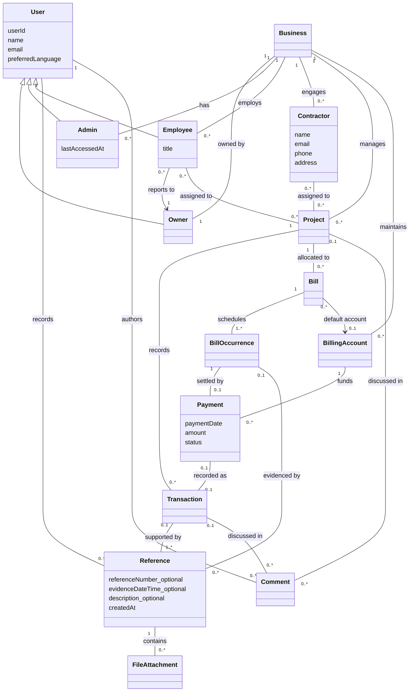

# Domain model

Contractors are external contacts, not users. Owner, Admin, and Employee are user roles; all employees report to the owner. Each user belongs to one business. References and payment states follow the agreed model, with a required primary reference enforcing the transaction's evidence relationship.

Additional constraints: a reference has at least one target and one piece of evidence; a comment has exactly one target. A processed payment has exactly one expense transaction; processing/failed payments have none. Shared transaction/occurrence references identify the same payment. Monetary storage uses cents; project balances are derived. The implementation uses role columns and assignment relations rather than separate Owner/Admin/Employee tables.
